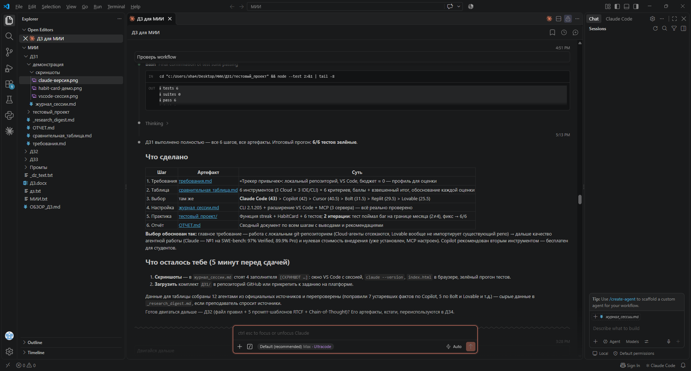
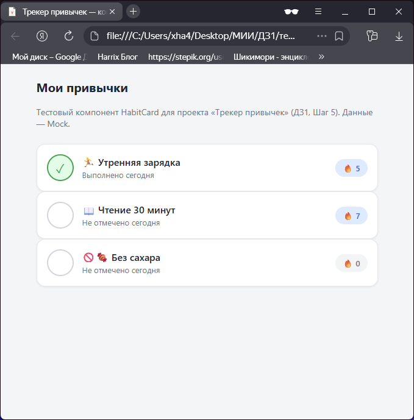

# ДЗ1 · Журнал рабочей сессии с AI-агентом (Шаги 4–5)

**Инструмент:** Claude Code 2.1.205 (CLI + расширение VS Code)
**Среда:** Windows 11, VS Code 1.141.0, Node v24.18.0, npm 11.16.0, Git 2.55.0
**Дата:** 8 октября 2026

---

## 1. Настройка окружения (Шаг 4) — что реально сделано

| Компонент | Состояние | Как проверено |
|---|---|---|
| Claude Code CLI | Установлен, версия 2.1.205 | `claude --version` |
| Расширение Claude Code для VS Code | Установлено, активно | сессия ведётся из VS Code |
| MCP (Model Context Protocol) | Настроен, 3 сервера: `claude-vscode` (диагностика редактора), `web-reader` (чтение веб-страниц), `4-5v-mcp` (анализ изображений) | MCP-инструменты видны в сессии и вызываются |
| Node.js / npm | v24.18.0 / 11.16.0 | `node --version`, `npm --version` |
| Git | 2.55.0.windows.2 | `git --version` |
| Тестовый проект | Создан агентом: `ДЗ1/тестовый_проект/` | см. ниже |

Настройка MCP требованием задания («если требуется») — выполнена: серверы подключены и используются в работе (web-reader применялся при исследовании инструментов, claude-vscode — для диагностики).




## 2. Практическая задача (Шаг 5)

**Задача:** создать простой компонент и функцию для будущего проекта «Трекер привычек» — расчёт текущей серии (streak) выполнений привычки + карточка привычки (HabitCard) на Mock-данных.

### Промпт 1 (постановка задачи агенту)

> «Напиши для трекера привычек функцию calculateStreak(entries, today): entries — массив дат отметок 'YYYY-MM-DD', вернуть длину текущей серии; серия «жива», если последняя отметка — сегодня или вчера. Плюс компонент-карточка привычки на vanilla HTML/CSS/JS с Mock-данными, и юнит-тесты на node --test, включая случай перехода месяца.»

**Итерация 1 — результат:**
- Созданы `streak.js` (v1), `streak.test.js` (6 тестов), `index.html` (HabitCard, 3 привычки на Mock-данных).
- Прогон `node --test`: **5 из 6 прошли, 1 упал** — тест «переход месяца: 29–30 сентября + 1–2 октября → серия 4» получил `2 !== 4`.
- Причина (агент локализовал сам): в v1 соседние даты сравнивались по `getDate()` — номеру дня в месяце; на границе месяца 30 → 1 выглядит как разрыв.

**Итерация 2 — исправление:**
- Промпт: «Исправь: сравнивай полные даты в миллисекундах, а не номера дней».
- `streak.js` (v2): `const dayGap = Math.round((prev - cur) / 86400000)`.
- Прогон `node --test`: **6 из 6 прошли** (`pass 6, fail 0`).

**Итого: 2 итерации до зелёных тестов.**

### Реальные выводы консоли

Итерация 1 (фрагмент):
```
✖ переход месяца: 29-30 сентября + 1-2 октября -> серия 4
  AssertionError: Expected values to be strictly equal: 2 !== 4
ℹ pass 5  ℹ fail 1
```
Итерация 2:
```
✔ переход месяца: 29-30 сентября + 1-2 октября -> серия 4 (0.0864ms)
ℹ tests 6  ℹ pass 6  ℹ fail 0
```

### Возникшие сложности и как решились

| Сложность | Решение |
|---|---|
| Агент допустил логическую ошибку сравнения дат в v1 | Ошибка поймана автоматическим тестом (кейс границы месяца), а не «на глаз»; исправлена за одну итерацию. Урок: тесты на краевые случаи нужно просить сразу |
| Исследование инструментов web-агентами заняло ~2 часа (агент по Bolt.new дольше всех собирал и перепроверял данные, финальный вывод не прошёл валидацию схемы с первого раза) | Данные в итоге собраны полностью; Lesson: объёмные веб-исследования стоит разбивать на меньшие вопросы |
| Извлечение текста из ДЗ.docx давало склейку строк/потерю пробелов и кириллическую «кашу» в консоли (cp1251) | Текст извлечён повторно с записью файла напрямую в UTF-8; сверено с ручной выгрузкой — 0 содержательных расхождений |
| Два файла с буквой «й» в имени не читались инструментом Read (юникод-нормализация NFD в именах) | Прочитаны через glob-маски в bash |

## 3. Результаты задачи (артефакты)

- `тестовый_проект/streak.js` — функция расчёта серии (v2), работает и в Node, и в браузере
- `тестовый_проект/streak.test.js` — 6 юнит-тестов, все зелёные
- `тестовый_проект/index.html` — компонент HabitCard с Mock-данными (открывается в браузере, отметка по клику пересчитывает серию)
- `тестовый_проект/README.md` — как запустить




