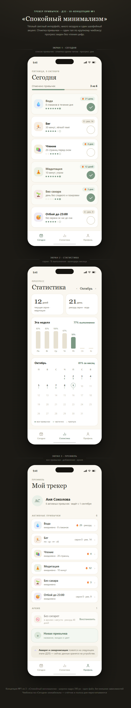
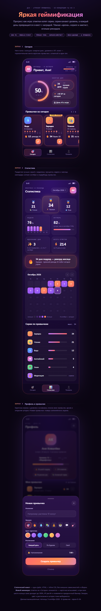
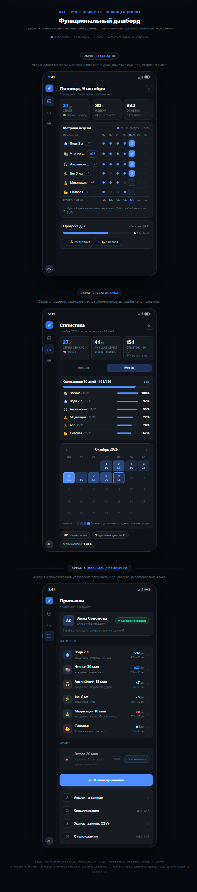

# ДЗ3 · Шаг 2 — UI-концепции (ui_description.md)

## Как получены концепции

Три концепции сгенерированы AI-агентами (Claude Code, 3 параллельных агента-дизайнера) как **экспорт кода** — самодостаточные HTML-макеты без внешних зависимостей (задание допускает «сохранить скриншоты **или** экспортировать код»). Каждый макет показывает все три экрана MVP («Сегодня», «Статистика», «Профиль/Привычки») последовательно, с mock-данными (6 привычек, разные серии, включая оборванную и рекордную) и кликабельными отметками.

| Файл | Концепция |
|---|---|
| [концепция-1-минимализм.html](концепция-1-минимализм.html) | «Спокойный минимализм» |
| [концепция-2-геймификация.html](концепция-2-геймификация.html) | «Яркая геймификация» |
| [концепция-3-дашборд.html](концепция-3-дашборд.html) | «Функциональный дашборд» |

Для просмотра: открыть файл в браузере (мобильный макет 390px на тёмной подложке). Скриншоты для сдачи снимаются с этих файлов.
Дополнительно ниже приведены промпты для «канонических» Text-to-UI сервисов (v0.dev / GalileoAI) — чтобы сгенерировать аналоги и приложить их скриншоты.

## Скриншоты концепций

Сняты с HTML-макетов (headless-браузер, полный скролл всех трёх экранов):

---

## Концепция 1 — «Спокойный минимализм»

**Слоган:** «Отметить привычку за пять секунд и спокойно закрыть приложение».

**Особенности.** Тёплая светлая палитра (бумажно-кремовый фон, почти-чёрный текст) с единственным акцентом — приглушённым шалфейно-зелёным; цвет привычки живёт только в пастельной подложке эмодзи-чипа. «Сегодня» — вертикальный карточный список: крупный круглый чекбокс 44px, скромный бейдж серии (оборванные — серые «0 · рек. N»). Микродиаграмма недели из 7 точек внутри каждой карточки. Статистика — крупные засечковые цифры и вертикальные столбики недели; календарь месяца точками трёх состояний. Нижняя таб-навигация из трёх пунктов. Типографика: крупные засечковые заголовки + системный гротеск — спокойный «редакционный» тон.

**Преимущества:** отметка действительно один тап (крупный чекбокс под большим пальцем); низкая когнитивная нагрузка (один акцентный цвет = «сделано», прогресс читается без цифр); тёплая палитра не давит при ежедневном утро/вечер использовании; единый язык прогресса (точки/столбики/календарь); легко масштабируется настройками и тёмной темой (ДЗ5).

**Недостатки:** низкая эмоциональность — слабее дофаминовая петля, геймификации почти нет; скромные бейджи серий не «празднуют» рекорд; меньше данных на экране, длинный список требует прокрутки; засечковая типографика требовательна к аккуратности реализации.

**Ближайшая ЦА:** ядро 25–35, ведущее привычки осознанно и без игры; уставшие от пёстрых трекеров; «бумажный трекер в телефоне».

## Концепция 2 — «Яркая геймификация»

**Слоган:** «Отметь день — прокачай себя: серии, уровни и рекорды вместо скучных галочек».

**Особенности.** Hero-зона «энергия дня»: крупное SVG-кольцо прогресса с коралл-аметистовым градиентом и свечением, чипы «лучшая серия / +XP / день в игре». Сквозная игровая метафора: уровень и XP-бар в шапке, ачивки, пьедестал с медалями в статистике. Горизонтальная лента-карусель карточек со scroll-snap: крупная эмодзи-плитка, серия жирным с огоньком, чек-кнопка в один тап. Календарь-хитмап месяца (5 уровней насыщенности). Тёмно-фиолетовая «арена», рамки со свечением, микроанимации (заполнение кольца, «пружинка» галочки, hover-подъём; отключаются через prefers-reduced-motion). Моношрифтовый HUD-слой микроподписей.

**Преимущества:** сильная эмоциональная вовлечённость (XP, медали — немедленная награда за тап); дневной прогресс виден за секунду (кольцо); рекорды празднуются — эффект «не потерять серию» (Duolingo); базовые сценарии остаются простыми; яркий тёмный стиль выделяется среди светлых трекеров.

**Недостатки:** эмоциональные качели — обрыв серии на контрасте с праздничным тоном демотивирует; градиенты и свечения утомляют при ежедневном использовании и хуже читаются на дешёвых экранах; горизонтальная лента прячет привычки за скроллом (при 8–10 обзор дня теряется); много декоративных слоёв утяжеляет развитие дизайн-системы.

**Ближайшая ЦА:** младшая половина ядра 20–30, геймерски социализированная (Duolingo/Strava), кому нужна внешняя мотивация на старте.

## Концепция 3 — «Функциональный дашборд»

**Слоган:** «Вся неделя — в одной матрице: отметка в один тап, данные вместо украшений».

**Особенности.** Недельная матрица «привычки × дни недели» в центре экрана «Сегодня»: точка = выполнение, кольцо = пропуск; колонка «сегодня» подсвечена и кликабельна — отметка прямо в матрице. Компактные метрики-плитки в шапке (серия, % недели, всего отметок). Боковое вертикальное меню-рейл 46px вместо нижней навигации. Строка «Итого/день» под матрицей. Календарь месяца — таблица с интенсивностью заливки и точным ratio «5/6» в ячейке, с легендой. Мелкая функциональная типографика (10–12px, табличные цифры, капс-микроподписи). Работающий переключатель «Неделя/Месяц».

**Преимущества:** максимальная плотность — неделя и серии без лишних тапов; пробелы видны сразу (встроенная самодиагностика); строгий единый визуальный язык, дёшево темизировать и переносить в React 1:1; данные дублируются текстом — читаемость при CVD и для скринридеров.

**Недостатки:** плотность и мелкий кегль утомляют на ходу и на солнце (риск для 35–45); мало эмоциональной награды — мотивация слабее; при >8–10 привычках матрица ломает идею «всё сразу»; боковой рейл съедает ~12% ширины на 390px.

**Ближайшая ЦА:** 20–35 с аналитическим складом (quantified self, Notion-аудитория); старшая часть 40–45, читающая приложение как инструмент.

---

## Сравнение и выбор

| Критерий (из ценности продукта) | №1 Минимализм | №2 Геймификация | №3 Дашборд |
|---|---|---|---|
| «Отметка за 5 секунд» | ✅ крупный чекбокс, список сверху | ✅ но лента требует свайпов при >4 привычек | ✅ тап прямо в матрице |
| Мотивация/дофамин | ◐ умеренная | ✅ максимальная | ◐ слабая |
| Ежедневное использование (утро/вечер, не утомляет) | ✅ | ◐ утомляет | ◐ мелкий кегль |
| Риск демотивации при обрыве серии | низкий | **высокий** | низкий |
| Читаемость на мобильном/на солнце | ✅ | ◐ | ✕ |
| Готовность к ДЗ4 (Tailwind, адаптив, состояния) | ✅ простая система | ◐ много слоёв | ✅ сетки |
| Соответствие ядерной ЦА 25–45 | ✅ | смещение к 20–30 | частично к 40+ |

**Выбрана Концепция 1 «Спокойный минимализм».**

Обоснование. Ядро продукта — ценность «отметка за 5 секунд» и ежедневный ритуал без трения: концепция №1 единственная одновременно даёт мгновенную отметку, не утомляет при ежедневном утро/вечернем использовании и точно попадает в ядерную ЦА (25–45, уставшую от перегруженных трекеров — это прямо из описания проекта). Решающие факторы: один акцентный цвет = однозначная семантика прогресса; единый язык «закрашенности» (точки → столбики → календарь) масштабируется на статистику ДЗ4 без новой дизайн-логики; наименьший риск при реализации в Tailwind (меньше декоративных слоёв — выше шанс уложиться в адаптивность и состояния loading/error/success, обязательные по критериям ДЗ4).

Почему не альтернативы: №2 сильнее всего мотивирует, но её ключевые риски — демотивация при обрыве серии (противоречит поддерживающей роли трекера) и утомительность при ежедневном использовании; кроме того, обилие декоративных слоёв повышает цену качественной адаптивной реализации. №3 информативнее всех, но мелкий кегль и плотность конфликтуют с мобильным сценарием «на ходу», а эмоциональная составляющая (ядро привычек) слабейшая. Отдельные удачные элементы альтернатив зафиксированы как возможные заимствования в будущих версиях: кольцо дневного прогресса (№2) и строка «итого/день» (№3) — вне рамок выбранной концепции MVP.

---

## Промпты для Text-to-UI сервисов (v0.dev / GalileoAI)

Для генерации аналогов концепций в «канонических» сервисах из задания (и получения живых скриншотов):

**Концепция 1:** `Minimal habit tracker mobile app, warm paper-white background, near-black text, single sage-green accent. "Today" screen: vertical card list of habits, each with emoji chip, small streak badge and a 7-dot week micro-chart, large 44px round checkbox on the right. Statistics screen: big serif numbers (current streak / record), vertical week bars, month calendar with dots. Bottom tab navigation: Today / Stats / Profile. Editorial serif headings, generous whitespace.`

**Концепция 2:** `Vibrant gamified habit tracker mobile app, dark purple arena background with coral-amethyst gradients and glow. Hero: large animated SVG progress ring of the day, level and XP bar in header. Horizontal snap-scroll cards with big emoji tiles, bold streak counters with fire icon. Month heatmap calendar with 5 intensity levels. Medals podium on stats screen, achievements in profile. Monospace HUD micro-labels, playful animations.`

**Концепция 3:** `Dense functional habit tracker dashboard, dark graphite theme with single blue accent. Central week matrix "habits × weekdays" with dots for completions, clickable today column. Compact metric tiles in header (streak, weekly %, total check-ins). Left vertical icon rail navigation. Month calendar table with per-cell intensity and explicit "5/6" ratios, legend. Small 10–12px functional typography, tabular numbers, uppercase micro-labels.`
