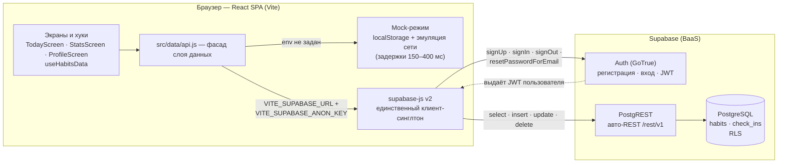

# Документация бэкенда (ДЗ5, Supabase)

Схема данных, доступ и развёртывание облачной части «Трекера привычек»:
PostgreSQL + Auth + Row Level Security в [Supabase](https://supabase.com),
доступ из React SPA — через `@supabase/supabase-js` (PostgREST auto-REST).
Документ описывает фактическое состояние кода: [`supabase/migrations/`](supabase/migrations/),
[`src/data/supabaseBackend.js`](src/data/supabaseBackend.js), [`src/data/api.js`](src/data/api.js).

**Содержание**

1. [Архитектура решения](#1-архитектура-решения)
2. [Модель данных](#2-модель-данных)
3. [Инструкции по развёртыванию](#3-инструкции-по-развёртыванию)
4. [Описание API endpoints](#4-описание-api-endpoints)
5. [Обработка ошибок](#5-обработка-ошибок)
6. [Процесс разработки с AI](#6-процесс-разработки-с-ai)

---

## 1. Архитектура решения

### 1.1. Схема



Ключевые точки:

- **Фасад `src/data/api.js`.** Экраны и хуки знают только его функции
  (`fetchHabits`, `createHabit`, `toggleCheckIn`, …). Если заданы обе
  env-переменные (`VITE_SUPABASE_URL`, `VITE_SUPABASE_ANON_KEY`), вызовы
  делегируются реальному бэкенду `src/data/supabaseBackend.js`; иначе работает
  Mock поверх localStorage. Контракт функций одинаков для обоих режимов,
  поэтому UI не различает, куда уходит запрос.
- **Mock-фолбэк.** Отсутствие env-переменных — не ошибка, а режим: приложение
  полностью работоспособно локально (демо-данные, эмуляция задержек и сбоев
  сети). Это позволяет запускать проект без аккаунта Supabase и не ломает
  тесты в CI, где переменные не заданы.
- **Единственный клиент supabase-js** создаётся лениво и переиспользуется;
  сессия (`persistSession`, `autoRefreshToken`) хранится в localStorage,
  токен из ссылок подтверждения email подхватывается автоматически
  (`detectSessionInUrl`).
- **Доверенная граница — сервер.** `user_id` строкам проставляет Postgres
  через `default auth.uid()`, а не клиент. Даже скомпрометированный фронтенд
  не может записать чужие строки: политики RLS проверяют `auth.uid() = user_id`
  на каждую операцию.

### 1.2. Почему Supabase, а не self-hosted

| Критерий | Supabase (BaaS) | Self-hosted (VPS + Docker) |
|---|---|---|
| Auth (email + пароль, JWT) | из коробки (GoTrue) | свой модуль или Keycloak — разработка и настройка |
| REST API к таблицам | авто (PostgREST) | свой API-слой (Express/FastAPI) + CORS |
| Разграничение доступа | RLS на уровне строк, декларативно | ручные проверки в каждом обработчике |
| Инфраструктура | ничего: проект создаётся в дашборде | VPS, Docker Compose, обновления, бэкапы, TLS |
| Тариф | бесплатного хватает на учебный проект | оплата VPS |
| Миграции | SQL-файлы + SQL Editor / CLI | тот же SQL + свой pipeline |

Для учебного сквозного проекта self-hosted означал бы недели работы над
инфраструктурой вместо логики приложения: Docker-стек, свой auth, CORS,
TLS-сертификаты. Supabase закрывает Auth, REST и построчную безопасность
декларативно, оставляя в проекте три небольших SQL-файла миграций и один
модуль адаптера. Минус — привязка к провайдеру — для учебного проекта приемлем:
схема — обычный PostgreSQL, при необходимости переносится дампом.

---

## 2. Модель данных

Миграции применяются по порядку:
[`supabase/migrations/0001_init.sql`](supabase/migrations/0001_init.sql)
(таблицы, ограничения, индексы) →
[`supabase/migrations/0002_rls_policies.sql`](supabase/migrations/0002_rls_policies.sql)
(RLS и политики) →
[`supabase/migrations/0003_checkin_habit_ownership.sql`](supabase/migrations/0003_checkin_habit_ownership.sql)
(усиление insert/update-политик `check_ins`: отметка — только на свою
привычку). Все три идемпотентны — повторный запуск безопасен; команды
отката — в [`supabase/README.md`](supabase/README.md).

### 2.1. Таблица `habits`

| Поле | Тип | Ограничения | Назначение |
|---|---|---|---|
| `id` | uuid | PK, `default gen_random_uuid()` | идентификатор привычки |
| `user_id` | uuid | NOT NULL, `default auth.uid()`, FK → `auth.users(id)` `ON DELETE CASCADE` | владелец; проставляет сервер |
| `title` | text | NOT NULL, CHECK `char_length(trim(title)) between 1 and 40` | название (та же норма, что в UI) |
| `emoji` | text | NOT NULL, `default '💪'` | эмодзи-иконка |
| `color` | text | NOT NULL, `default '#7C9883'`, CHECK `color ~ '^#[0-9A-Fa-f]{6}$'` | hex-цвет токена палитры |
| `created_at` | date | NOT NULL, `default current_date` | дата создания |
| `archived_at` | date | NULL | `NULL` — активная; дата — день архивации |

### 2.2. Таблица `check_ins`

| Поле | Тип | Ограничения | Назначение |
|---|---|---|---|
| `habit_id` | uuid | NOT NULL, FK → `habits(id)` `ON DELETE CASCADE`, часть PK | привычка |
| `user_id` | uuid | NOT NULL, `default auth.uid()`, FK → `auth.users(id)` `ON DELETE CASCADE` | владелец |
| `date` | date | NOT NULL, CHECK `date <= current_date`, часть PK | день отметки; будущее запрещено |
| `created_at` | timestamptz | NOT NULL, `default now()` | техническое время вставки |

Составной PK `(habit_id, date)` даёт максимум одну отметку на привычку в день
на уровне схемы — «тумблер» клиента реализуется парой `insert` / `delete`.
Каскады `ON DELETE CASCADE` удаляют отметки вместе с привычкой и данные
пользователя вместе с аккаунтом.

### 2.3. Индексы

| Индекс | Таблица (колонки) | Под какой запрос |
|---|---|---|
| `idx_habits_user_id` | `habits (user_id)` | список привычек пользователя |
| `idx_check_ins_user_id_date` | `check_ins (user_id, date)` | выборка отметок по диапазону дат (неделя/месяц) |
| PK-индексы | `habits (id)`, `check_ins (habit_id, date)` | точечные чтения и проверки тумблера (создаются автоматически) |

### 2.4. RLS-политики

RLS включена на обеих таблицах (`alter table … enable row level security`):
без подходящей политики строка недоступна клиентским ролям вообще. Политики
действуют только для роли `authenticated` (залогиненные клиенты); anon-сессия
не проходит условие `auth.uid() = user_id`.

| Таблица | Политика | Операция | USING | WITH CHECK |
|---|---|---|---|---|
| `habits` | `habits_select_own` | SELECT | `auth.uid() = user_id` | — |
| `habits` | `habits_insert_own` | INSERT | — | `auth.uid() = user_id` |
| `habits` | `habits_update_own` | UPDATE | `auth.uid() = user_id` | `auth.uid() = user_id` |
| `habits` | `habits_delete_own` | DELETE | `auth.uid() = user_id` | — |
| `check_ins` | `check_ins_select_own` | SELECT | `auth.uid() = user_id` | — |
| `check_ins` | `check_ins_insert_own` | INSERT | — | `auth.uid() = user_id` + привычка `habit_id` — своя (0003) |
| `check_ins` | `check_ins_update_own` | UPDATE | `auth.uid() = user_id` + привычка — своя (0003) | `auth.uid() = user_id` + привычка — своя (0003) |
| `check_ins` | `check_ins_delete_own` | DELETE | `auth.uid() = user_id` | — |

`WITH CHECK` у insert/update не даёт «подарить» строку другому пользователю.
REVOKE грантов не требуется: RLS фильтрует строки, оставляя стандартные
полномочия роли `authenticated`.

Миграция
[`0003_checkin_habit_ownership.sql`](supabase/migrations/0003_checkin_habit_ownership.sql)
усилила insert/update-политики `check_ins`: кроме `user_id = auth.uid()`
условия `USING` и `WITH CHECK` теперь содержат проверку принадлежности
привычки — формулировка из 0003:

```sql
user_id = auth.uid()
and exists (
  select 1 from habits h
  where h.id = check_ins.habit_id
    and h.user_id = auth.uid()
)
```

Отметку нельзя поставить или «перепривязать» на чужую привычку даже
рукотворным запросом: вставка со своим `user_id` и чужим `habit_id`
отклоняется ошибкой 42501. Select/delete-политики не менялись: чужие
отметки и так не читаются, а после закрытия вставки новые не возникают.

### 2.5. Маппинг к модели фронтенда

Адаптер `supabaseBackend.js` переводит строки БД (snake_case) в модель
приложения (camelCase); даты приходят из Postgres уже строками `'YYYY-MM-DD'`,
конвертация не нужна.

| Фронтенд (`Habit` / `CheckIn`) | БД | Примечание |
|---|---|---|
| `Habit.id` | `habits.id` | uuid |
| `Habit.title` | `habits.title` | 1–40 символов после trim |
| `Habit.emoji` | `habits.emoji` | default `'💪'` |
| `Habit.color` | `habits.color` | формат `#RRGGBB` |
| `Habit.createdAt` | `habits.created_at` | date → строка |
| `Habit.archivedAt` | `habits.archived_at` | null или строка-дата |
| `CheckIn.habitId` | `check_ins.habit_id` | uuid |
| `CheckIn.date` | `check_ins.date` | date → строка |
| — | `*.user_id`, `check_ins.created_at` | клиент не читает и не передаёт |

---

## 3. Инструкции по развёртыванию

### 3.1. Создание проекта и применение миграций

1. Зарегистрируйтесь на [supabase.com](https://supabase.com) → **New project**:
   имя (`habit-tracker`), пароль БД, регион ближе к пользователям
   (для РФ — `eu-central-1`, Франкфурт). Бесплатного тарифа достаточно.
2. Дождитесь статуса проекта **Running**, откройте **SQL Editor → New query**.
3. Вставьте целиком содержимое [`supabase/migrations/0001_init.sql`](supabase/migrations/0001_init.sql)
   → **Run**. Должно появиться `Success. No rows returned`.
4. Создайте новый запрос, вставьте
   [`supabase/migrations/0002_rls_policies.sql`](supabase/migrations/0002_rls_policies.sql)
   → **Run**. Порядок обязателен: вторая миграция ссылается на таблицы первой.
5. Третим запросом примените
   [`supabase/migrations/0003_checkin_habit_ownership.sql`](supabase/migrations/0003_checkin_habit_ownership.sql)
   → **Run**: она заменяет insert/update-политики `check_ins` версиями,
   дополнительно требующими, чтобы привычка принадлежала пользователю.
6. Проверьте применение (роль postgres обходит RLS — годится для служебных
   запросов):

   ```sql
   select tablename, rowsecurity from pg_tables
   where schemaname = 'public' and tablename in ('habits', 'check_ins');
   -- ОЖИДАЕТСЯ: habits | true, check_ins | true

   select tablename, policyname, cmd from pg_policies
   where schemaname = 'public' order by tablename, policyname;
   -- ОЖИДАЕТСЯ: 8 политик — habits_*_own и check_ins_*_own
   -- (0003 пересоздаёт две из них; полные условия — в колонках
   --  qual / with_check: там exists-проверка владельца привычки)
   ```

Альтернатива — Supabase CLI: `npx supabase link --project-ref <REF>` и
`npx supabase db push` применит всё из `supabase/migrations/` (см.
[`supabase/README.md`](supabase/README.md)).

### 3.2. Ключи и `.env`

7. В дашборде откройте **Settings → API** и скопируйте:
   - **Project URL** — вида `https://<project-ref>.supabase.co`;
   - ключ **anon public** (Project API keys).
8. В корне проекта: `cp .env.example .env` и заполните:

   ```dotenv
   VITE_SUPABASE_URL=https://<project-ref>.supabase.co
   VITE_SUPABASE_ANON_KEY=<anon public key>
   ```

   **anon-ключ — публичный:** он зашит в клиент и безопасен именно потому,
   что все таблицы под RLS. Ключ `service_role` обходит RLS — использовать
   во фронтенде запрещено (правило 9 CLAUDE.md: секретов в репозитории нет,
   `.env` в `.gitignore`, в репозитории только `.env.example`).

### 3.3. Запуск

9. `npm install` (зависимость `@supabase/supabase-js` уже в `package.json`).
10. `npm run dev` → <http://localhost:5173>. С заполненным `.env` приложение
   работает в облачном режиме (регистрация/вход, данные в Supabase); без
   `.env` — в Mock-режиме (localStorage, демо-данные).

### 3.4. Как проверить RLS

Полный набор проб с подменой JWT-клеймов — в
[`supabase/README.md`](supabase/README.md), раздел «Проверка RLS». Суть:

| Проба | Ожидание |
|---|---|
| `select * from habits` под пользователем A (через `set_config('request.jwt.claims', …)` + `set local role authenticated`) | возвращаются только строки A |
| `insert` привычки с `user_id` пользователя B | `ERROR 42501 … violates row-level security policy` |
| `insert into habits (title) values (…) returning user_id` | строка создаётся, `user_id` = A, хотя не передавался |
| отметка с `date = current_date + 1` | `ERROR 23514 … check_ins_date_not_future` |
| `insert into check_ins` со своим `user_id`, но чужим `habit_id` | `ERROR 42501` — привычка не принадлежит пользователю (политика 0003) |
| `delete` привычки | её отметки исчезают (каскад), `count(*) = 0` |

Быстрая проверка без SQL — из консоли браузера под реальной сессией:
`supabase.from('habits').select()` возвращает только свои строки, вставка
с чужим `user_id` приходит с ошибкой 42501.

---

## 4. Описание API endpoints

REST API не пишется руками: **PostgREST** публикует таблицы как
`{SUPABASE_URL}/rest/v1/{таблица}`. Каждый запрос несёт два заголовка —
`apikey: <anon-ключ>` и `Authorization: Bearer <JWT>` (анон-ключ для
гостевых запросов, access-токен пользователя — для данных).

### 4.1. Привычки

| Операция | Метод и путь | К body / условия | RLS-политика |
|---|---|---|---|
| Активные привычки (экран «Сегодня») | `GET /rest/v1/habits?select=id,title,emoji,color,created_at,archived_at&archived_at=is.null&order=created_at.asc` | — | `habits_select_own` |
| Все привычки, включая архив (экран «Профиль») | `GET /rest/v1/habits?select=…&order=created_at.asc,id.asc` | — | `habits_select_own` |
| Создание | `POST /rest/v1/habits` | `{ "title", "emoji"?, "color"? }`; `title` 1–40 после trim, `color` `#RRGGBB`; `user_id` и `created_at` проставляют default-ы | `habits_insert_own` |
| Редактирование | `PATCH /rest/v1/habits?id=eq.<uuid>` | патч `{ "title"? / "emoji"? / "color"? }` | `habits_update_own` |
| Архивация / восстановление | `PATCH /rest/v1/habits?id=eq.<uuid>` | `{ "archived_at": "YYYY-MM-DD" }` или `{ "archived_at": null }` | `habits_update_own` |

Удаление привычки (`DELETE /rest/v1/habits?id=eq.<uuid>`,
`habits_delete_own`) в UI не используется — вместо него мягкая архивация;
политика оставлена для каскадной зачистки при удалении аккаунта.

### 4.2. Отметки

| Операция | Метод и путь | К body / условия | RLS-политика |
|---|---|---|---|
| Отметки пользователя | `GET /rest/v1/check_ins?select=habit_id,date&order=date.asc` | — | `check_ins_select_own` |
| Поставить отметку | `POST /rest/v1/check_ins` | `{ "habit_id", "date" }`; `date <= current_date`; повторная пара `(habit_id, date)` отклоняется PK (23505) | `check_ins_insert_own` |
| Снять отметку | `DELETE /rest/v1/check_ins?habit_id=eq.<uuid>&date=eq.<YYYY-MM-DD>` | — | `check_ins_delete_own` |

Пара «поставить/снять» — это «тумблер» `toggleCheckIn`: адаптер сначала
проверяет наличие строки, затем делает insert или delete; гонка двух
клиентов (оба успели поставить) разрешается обработкой 23505. Политики
`check_ins_update_own` покрывают гипотетическое редактирование — отметки
логически неизменяемы (только insert/delete).

### 4.3. Аутентификация

Auth-операции вызываются методами supabase-js (`client.auth.*`), а не
REST-руками — SDK сам ставит заголовки, хранит и обновляет токен. Под ними
лежат эндпоинты GoTrue (`{SUPABASE_URL}/auth/v1/…`):

| Операция | Метод | Реализация в `supabaseBackend.js` |
|---|---|---|
| Регистрация | `POST /auth/v1/signup` | `signUp` — при включённом подтверждении email сессии сразу нет (`needsConfirmation`) |
| Вход | `POST /auth/v1/token?grant_type=password` | `signIn` (`signInWithPassword`) |
| Выход | `POST /auth/v1/logout` | `signOut` |
| Сброс пароля | `POST /auth/v1/recover` | `requestPasswordReset` — ответ не раскрывает существование email |
| Сессия / обновление токена | `GET /auth/v1/user`, `POST /auth/v1/token?grant_type=refresh_token` | `getSession`, `onAuthChange`; автообновление включено в клиенте |

### 4.4. Примеры запросов (curl)

Примеры для Git Bash / WSL. Заголовок `apikey` и `Authorization` обязательны
на каждый запрос.

```bash
SUPABASE_URL="https://<project-ref>.supabase.co"
ANON_KEY="<anon public ключ из Settings → API>"   # публичный ключ, не секрет

# 1) Список привычек. Под anon-ключом (гость, роль anon) RLS-политики
#    "to authenticated" не пропускают ни одной строки — вернётся [].
curl -s "$SUPABASE_URL/rest/v1/habits?select=id,title,emoji,color,created_at,archived_at" \
  -H "apikey: $ANON_KEY" \
  -H "Authorization: Bearer $ANON_KEY"
# []

# 2) Создание привычки гостем отклоняется политикой habits_insert_own.
#    PostgREST переводит нарушение RLS (ошибка PG 42501) в HTTP 403
#    Forbidden — не в 401 (401 приходит только с протухшим JWT):
#    403 / {"code":"42501","message":"new row violates row-level ..."}
curl -s -X POST "$SUPABASE_URL/rest/v1/habits" \
  -H "apikey: $ANON_KEY" \
  -H "Authorization: Bearer $ANON_KEY" \
  -H "Content-Type: application/json" \
  -H "Prefer: return=representation" \
  -d '{"title":"Утренняя зарядка","emoji":"💪","color":"#7C9883"}'
```

Реальные данные требует JWT **залогиненного пользователя** — его выдаёт
вход (то, что в приложении делает `signIn`):

```bash
# Вход пользователя, извлекаем access_token (пароль тестового аккаунта)
USER_JWT=$(curl -s "$SUPABASE_URL/auth/v1/token?grant_type=password" \
  -H "apikey: $ANON_KEY" -H "Content-Type: application/json" \
  -d '{"email":"user-a@example.com","password":"<пароль>"}' \
  | python -c "import sys,json; print(json.load(sys.stdin)['access_token'])")

# Список привычек — уже только строки этого пользователя (habits_select_own)
curl -s "$SUPABASE_URL/rest/v1/habits?select=id,title&archived_at=is.null" \
  -H "apikey: $ANON_KEY" \
  -H "Authorization: Bearer $USER_JWT"

# Создание привычки — user_id подставит default auth.uid()
curl -s -X POST "$SUPABASE_URL/rest/v1/habits" \
  -H "apikey: $ANON_KEY" -H "Authorization: Bearer $USER_JWT" \
  -H "Content-Type: application/json" -H "Prefer: return=representation" \
  -d '{"title":"Утренняя зарядка","emoji":"💪","color":"#7C9883"}'
```

То, что гостю недоступно ничего, а пользователю — только его строки, и есть
наглядная работа RLS: те же пробы в SQL-виде — в [`supabase/README.md`](supabase/README.md).

---

## 5. Обработка ошибок

### 5.1. Нормализация в доменные коды

`supabaseBackend.js` переводит любую ошибку запроса в один из доменных
кодов, единых с Mock-режимом:

| Источник | Признак | Код | Что означает |
|---|---|---|---|
| Нет сети / DNS / CORS | `TypeError`, `fetch failed` | `NETWORK` | транспорт недоступен |
| 0 строк у `.single()` | PostgREST `PGRST116` | `NOT_FOUND` | запись не найдена (или чужая — RLS скрыл) |
| Нарушение FK | Postgres `23503` | `NOT_FOUND` | ссылка на несуществующую привычку |
| Нарушение CHECK | Postgres `23514` | `INVALID_DATA` | название вне 1–40, цвет не `#RRGGBB`, дата в будущем |
| Нет сессии / токен истёк | HTTP `401` | `AUTH` | нужно войти |
| Нарушение PK (гонка тумблера) | Postgres `23505` | не ошибка | второй клиент уже поставил отметку — тумблер корректно завершает снятием |
| прочее | — | `NETWORK` | консервативный fallback |
| Auth-операции | текст Supabase | текст человеку | «занятый email», «неверный пароль» — показываются в форме |

Название проверяется на клиенте до запроса (`assertValidTitle` — та же
ошибка, что в Mock), поэтому типовой путь ошибки валидации не тратит запрос.

### 5.2. Отображение в UI

Контракт состояний — правило 5 CLAUDE.md: у каждой асинхронной операции
обязательны `loading` / `error` / `success`. Реализовано в
[`src/hooks/useHabitsData.js`](src/hooks/useHabitsData.js):

- **Загрузка.** Первая — со скелетонами (`loading`); повторная после
  создания привычки — «тихая», без мигания готового списка. Защита
  `requestId` отбрасывает устаревшие ответы.
- **Ошибка загрузки** (`NETWORK` и любые другие) → `ErrorBanner` с текстом
  «Не удалось загрузить данные. Проверьте соединение и попробуйте ещё раз»
  и повтором по `reload()`.
- **Оптимистичная отметка с откатом.** Чекбокс переключается мгновенно;
  при сбое сохранения изменение откатывается **хирургически** — только одна
  отмеченная клетка (`withDone(prev, habitId, date, wasDone)`), соседние
  оптимистичные изменения не затираются — и показывается баннер
  «Не удалось сохранить отметку — изменение отменено». Если ответ сервера
  разошёлся с прогнозом (данные менялись с другого устройства), UI доверяет
  серверу.
- **`AUTH`** — отдельной ветки в UI нет. Адаптер маппит в этот код HTTP 401
  и бросает его же из `requireSession()` без сессии, но `useHabitsData`
  не различает его с сетевым сбоем: общий `ErrorBanner` «Не удалось
  загрузить данные…» с кнопкой «Повторить» (`reload()`). Экрана входа из
  ошибки данных не существует — вход всегда через блок `AuthBlock`
  в «Профиле» (гостевой режим по умолчанию, FR-66); после успешного входа
  экраны перезагружают данные (`handleSignedIn` → `load()`).

**Известные упрощения.** Ошибка `AUTH` показывается как общая ошибка
загрузки, а не приглашением войти: подсказка «войдите в Профиле» в баннере
не выводится — пользователь добирается до входа сам.

### 5.3. Логирование

- **Клиент:** `console.error` с контекстом в точке сбоя
  (`useHabitsData: загрузка не удалась`, `supabaseBackend: привычка не
  перенесена` и т.п.) — видно в DevTools консоли.
- **Сервер:** Supabase Dashboard → **Logs → API** (каждый PostgREST-запрос
  со статусом и длительностью — здесь видны 401/403/23514) и **Logs →
  Auth** (регистрации, входы, сбросы пароля). Уровень логов и время
  хранения настраиваются в Settings → Logs.

---

## 6. Процесс разработки с AI

ДЗ5 выполнялось оркестратором, разбивающим работу на параллельные шаги
для отдельных агентов. Каждому агенту выдавался **промпт-контракт** —
точное описание интерфейса, а не свободная постановка; готовые файлы затем
сводились и сверялись с контрактами. Правила проекта (CLAUDE.md: идемпотентные
миграции с откатом, JSDoc, состояния loading/error/success, никаких
секретов в репозитории) действовали для всех агентов одинаково.

| Шаг | Кто делал | Контракт, выданный агенту |
|---|---|---|
| Схема БД и миграции (`0001_init.sql`, `0002_rls_policies.sql`, `supabase/README.md`) | агент «схема» | таблицы/поля/CHECK/PK/индексы, имена политик `*_own`, условие `auth.uid() = user_id`, идемпотентность, команды отката, пробы RLS |
| Обоснование выбора BaaS и этот документ | агент «документация» | структура из шести разделов + контракты схемы и адаптера для сверки с фактическими файлами |
| Адаптер `src/data/supabaseBackend.js` | агент «бэкенд» | сигнатуры и семантика функций 1-в-1 как у Mock `api.js`; маппинг snake_case → camelCase; доменные коды ошибок; тумблер insert/delete |
| Фасад `src/data/api.js` | агент «интеграция» | переключение Mock/Supabase по факту env (`isConfigured()`), без правок экранов; auth-функции фасада |
| Auth-UI и сценарии аккаунта | агент «auth-UI» | контракт сессии для UI, коды ошибок форм (`EMAIL_EXISTS`, `INVALID_CREDENTIALS`), сценарии FR-54…FR-70 (регистрация, вход, сброс пароля, перенос локальных данных) |
| Сквозная проверка | оркестратор | сборка `npm run build`, тесты `npm test`, ручные сценарии входа/отметок/архивации |

Разделение «контракт → параллельная реализация → сверка» дало тот же
эффект, что интерфейсы в коде: агенты не зависели друг от друга, а
несовпадения с контрактом ловились на сверке, а не в рантайме.
