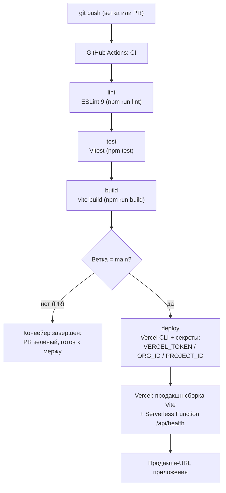

# Интеграции и эксплуатация (ДЗ6)

Документ описывает «обвязку» сквозного приложения «Трекер привычек»: конвейер CI/CD
и деплой на Vercel, вход через Google (OAuth2), продуктовую аналитику, мониторинг,
логирование и health-check. Рассчитан на повторение с нуля: каждый раздел —
пошаговая инструкция + способ проверить результат.

Правило безопасности одно на весь документ: **секреты живут только в переменных
окружения** (GitHub Secrets, Vercel Environment Variables, Supabase Dashboard).
В репозитории — лишь шаблон `.env.example`. Подробнее — в
[`security_audit.md`](security_audit.md).

---

## 1. CI/CD

### 1.1. Как устроен конвейер

Пуш в любую ветку запускает проверки качества (lint → test → build). Коммит в
`main` дополнительно деплоится на Vercel — вручную ничего собирать не нужно.



Любая красная ступень останавливает конвейер: сломанный код не попадает в `main`
и не деплоится.

### 1.2. Секреты GitHub Actions

Настраиваются один раз: репозиторий → **Settings → Secrets and variables →
Actions → New repository secret**.

| Секрет | Зачем | Где взять значение |
|---|---|---|
| `VERCEL_TOKEN` | деплой из CI от имени аккаунта Vercel | [vercel.com/account/tokens](https://vercel.com/account/tokens) → Create Token (scope — аккаунт/проект) |
| `VERCEL_ORG_ID` | в какую организацию (аккаунт) деплоить | команда `vercel link` в каталоге проекта — попадает в `.vercel/project.json` (поле `orgId`); либо Vercel → Project Settings → General |
| `VERCEL_PROJECT_ID` | какой именно проект Vercel деплоить | там же: `.vercel/project.json` (поле `projectId`) или Project Settings → General → Project ID |

`.vercel/` добавлен в `.gitignore` — токен и идентификаторы не попадают в
репозиторий.

### 1.3. Подключение Vercel (одноразово)

1. [vercel.com](https://vercel.com) → **Add New… → Project → Import Git Repository**
   — выбрать репозиторий курса (доступ выдаётся при первом импорте).
2. **Root Directory** = `ДЗ4/habit-tracker` — репозиторий курса монорепозиторий,
   приложение лежит в подпапке.
3. **Framework Preset** = Vite (Vercel подставит Build Command `npm run build`,
   Output Directory `dist` — убедиться, что так и осталось).
4. **Environment Variables** — добавить переменные из таблицы ниже (Production).
5. **Deploy** — первый деплой; дальше Vercel пересобирает приложение сам на каждый
   пуш в `main` (или из CI-джоба `deploy`).

### 1.4. Переменные окружения Vercel

Project Settings → **Environment Variables**. Значения те же, что в локальном
`.env` (Project Settings → API в Supabase).

| Переменная | Слой | Назначение |
|---|---|---|
| `VITE_SUPABASE_URL` | клиент | URL проекта Supabase (`https://<project-ref>.supabase.co`) |
| `VITE_SUPABASE_ANON_KEY` | клиент | публичный anon-ключ (данные защищает RLS) |
| `SUPABASE_URL` | сервер | то же URL — читает `/api/health` (без префикса `VITE_` в бандл не попадает) |
| `SUPABASE_ANON_KEY` | сервер | anon-ключ для заголовка `apikey` в health-check |
| `VITE_GA_MEASUREMENT_ID` | клиент | необязательно: включить Google Analytics 4 |
| `VITE_YM_COUNTER_ID` | клиент | необязательно: включить Яндекс.Метрику |
| `VITE_LOG_LEVEL` | клиент | необязательно: порог логгера (по умолчанию `info`) |

Ключ `service_role` указывать запрещено — он обходит RLS (см.
[`security_audit.md`](security_audit.md)).

### 1.5. Как проверить

1. **Actions зелёные**: репозиторий → вкладка Actions → последний запуск —
   все джобы `lint` / `test` / `build` / `deploy` (для `main`) с галочкой.
2. **Лог деплоя**: открыть джоб `deploy` — в выводе ссылка на Deployment
   (Production) в Vercel.
3. **URL отвечает**: открыть продакшн-домен — приложение загружается, вход в
   аккаунт работает; `https://<домен>/api/health` возвращает HTTP 200
   (`"status":"ok"`).

---

## 2. OAuth2: вход через Google

Flow целиком ведёт Supabase: приложение только запускает редирект и принимает
сессию после возврата. Client ID/Secret Google хранятся в Supabase, в коде и
репозитории их нет.

### 2.1. Google Cloud Console

1. [console.cloud.google.com](https://console.cloud.google.com) → создать или
   выбрать проект.
2. **APIs & Services → OAuth consent screen**: тип External, имя приложения
   («Трекер привычек»), добавить себя в Test users (для учебного проекта хватит
   тестового режима).
3. **APIs & Services → Credentials → Create Credentials → OAuth client ID** →
   тип **Web application**.
4. **Authorized JavaScript origins**:
   `https://<project-ref>.supabase.co` — `<project-ref>` берётся из URL проекта
   Supabase (Settings → API).
5. **Authorized redirect URIs**:
   `https://<project-ref>.supabase.co/auth/v1/callback`.
6. Сохранить и скопировать **Client ID** и **Client Secret**.

### 2.2. Supabase

1. **Authentication → Providers → Google** → включить и вставить Client ID /
   Client Secret из шага выше.
2. **Authentication → URL Configuration**:
   - **Site URL** = продакшн-URL (`https://<домен>.vercel.app`);
   - **Redirect URLs** — добавить: продакшн-URL и `http://localhost:5173/**`
     (последний — чтобы OAuth работал и в локальной разработке).

### 2.3. Как это работает в приложении

- Кнопка **«Войти через Google»** в `src/components/AuthBlock.jsx` вызывает
  `signInWithOAuth('google')` фасада `src/data/api.js`.
- `src/data/supabaseBackend.js` выполняет
  `client.auth.signInWithOAuth({ provider, options: { redirectTo:
  window.location.origin } })` — браузер уходит на Google, Supabase принимает
  ответ на `/auth/v1/callback` и возвращает пользователя на origin приложения.
- Сессию после возврата подхватывает `detectSessionInUrl` (стандартная настройка
  supabase-js): срабатывает `onAuthChange`, UI переключается на залогиненное
  состояние. Отдельный бэкенд-код не нужен.

### 2.4. Проверка

- Открыть приложение → «Войти через Google» → выбрать аккаунт Google →
  согласиться → возврат в приложение уже залогиненным.
- Ошибка `Unsupported provider` — провайдер не включён в Supabase (п. 2.2.1).
- Ошибка `redirect_uri_mismatch` в Google — URI в Google Cloud не совпадают
  посимвольно с п. 2.1.4–2.1.5.

---

## 3. Аналитика

Модуль `src/analytics/index.js` поддерживает **GA4 и/или Яндекс.Метрику** —
выбор определяется env. Скрипт счётчика вставляется динамически и только если ID
задан: без переменной приложение не грузит ни байта трекинга (полный no-op).
Если заданы оба ID — работают оба счётчика, событие уходит в каждый.

### 3.1. Получение идентификатора

- **Google Analytics 4**: [analytics.google.com](https://analytics.google.com) →
  Admin (шестерёнка) → Create Property → в нём **Data Streams → Add stream →
  Web** → указать URL приложения → скопировать **Measurement ID** вида
  `G-XXXXXXXXXX`.
- **Яндекс.Метрика**: [metrica.yandex.ru](https://metrica.yandex.ru) →
  **Добавить счётчик** → имя и адрес сайта → сохранить → запомнить числовой
  **номер счётчика** (например, `12345678`).

### 3.2. Включение

1. Локально: вписать ID в `.env` (см. `.env.example`):
   `VITE_GA_MEASUREMENT_ID` и/или `VITE_YM_COUNTER_ID`.
2. Продакшн: те же переменные добавить в Vercel — Project Settings →
   Environment Variables — и сделать Redeploy (env вшивается при сборке).

### 3.3. События

| Событие | Когда отправляется | Параметры |
|---|---|---|
| `screen_view` | открытие/переключение вкладки приложения (`src/App.jsx`) | `screen`: `today` \| `stats` \| `profile` |
| `habit_created` | успешное создание привычки в диалоге (`TodayScreen`) | — |
| `habit_toggled` | отметка или снятие отметки за день (`useHabitsData`) | `done`: итоговое состояние (`true`/`false`) |
| `habit_archived` | архивация привычки в профиле (`ProfileScreen`) | — |

В GA4 событие уходит как `gtag('event', …)` с параметрами, в Метрике — как цель
`reachGoal` с теми же параметрами.

### 3.4. Проверка

- GA4: **Reports → Realtime** — открыть приложение, увидеть себя и события при
  кликах; Метрика: **Отчёты → В реальном времени** (конверсии по целям).
- DevTools → Network: запросы к `googletagmanager.com` / `mc.yandex.ru`.

---

## 4. Мониторинг

### 4.1. UptimeRobot (бесплатный план)

1. [uptimerobot.com](https://uptimerobot.com) → Sign Up (free: 50 мониторов,
   интервал от 5 минут).
2. **Add New Monitor**.
3. **Monitor Type**: `HTTPS` (вариант: `Keyword` — дополнительно проверять
   вхождение `"status":"ok"` в тело ответа).
4. **URL (IP)**: `https://<домен>/api/health`.
5. **Monitoring Interval**: `5 minutes`.
6. Уведомления: email-алерт при переходе в down (и, при желании, при
   восстановлении).

### 4.2. Что означает `degraded`

Health-check отвечает `503 {"status":"degraded"}`, когда хотя бы одна из
проверок — БД (`GET /rest/v1/`) или Auth (`GET /auth/v1/health`) — не ответила
2xx за 5 секунд, либо не заданы серверные `SUPABASE_URL`/`SUPABASE_ANON_KEY`.
Сам Vercel при этом жив: недоступна зависимость (Supabase) или конфигурация.
UptimeRobot видит 503 как сбой и шлёт алерт — это сигнал смотреть Vercel
Functions Logs и [status.supabase.com](https://status.supabase.com).

### 4.3. Альтернативы

- **Vercel Status**: [vercel.status.com](https://vercel.status.com) — состояние
  инфраструктуры самого Vercel; в дашборде проекта — вкладка **Analytics**
  (трафик и доступность).
- Ручной контроль: Project → **Deployments → Functions Logs** + периодический
  `curl https://<домен>/api/health`.

---

## 5. Логирование

### 5.1. Формат записей

`src/utils/logger.js` пишет **структурированные логи**: одна запись — одна
строка JSON, удобная для фильтрации и разбора машиной:

```json
{"ts":"2026-10-09T18:30:12.345Z","level":"info","msg":"habit_created","habitId":"42"}
```

- Уровни: `debug` (трассировка) → `info` (штатные события) → `warning`
  (восстановимые сбои: откат оптимистичной отметки, retry) → `error` (операция
  не выполнена).
- Порог задаётся `VITE_LOG_LEVEL` (`debug` | `info` | `warning` | `error`,
  по умолчанию `info`); записи ниже порога не выводятся.
- Маршрут вывода: `error` → `console.error`, `warning` → `console.warn`,
  остальное → `console.log`. Единый формат на клиенте и на сервере.

### 5.2. Где смотреть логи

- **Серверные функции (продакшн)**: Vercel → проект → **Deployments** →
  актуальный Production-деплой → вкладка **Functions (Logs)** — вывод
  `console.*` из `/api/health` и будущих функций; строки можно фильтровать
  по уровню и времени.
- **Клиент**: DevTools → Console браузера (логгер работает и там).
- Логи алертов UptimeRobot дополняют картину по доступности.

### 5.3. Промпты для AI-анализа логов

Готовые промпты (задание Шага 7): подставить выгрузку логов и получить
первичную диагностику.

1. **Группировка ошибок.**
   «Вот JSON-логи (одна строка = одна запись `{ts, level, msg, …}`). Найди все
   записи уровня error и warning, сгруппируй по `msg`, посчитай количество и для
   каждой группы предложи вероятную причину и первый шаг диагностики. Ответ —
   таблица: msg | сколько | вероятная причина | что проверить в первую очередь.»
2. **Хронология инцидента.**
   «Вот фрагмент логов с момента инцидента (время аварии: …). Восстанови
   хронологию: какие события предшествовали первой ошибке, был ли повтор
   попытки и помог ли он, чем закончилось. Отдельно отметь аномалии latencyMs и
   подозрительно большие паузы между записями.»
3. **Правила мониторинга.**
   «Составь по этим логам чек-лист наблюдения: какие `msg` стоит взять в алерты
   и с какими порогами по частоте, какие записи — шум, который можно понизить
   до debug, и каких событий не хватает для полной картины инцидента.»

---

## 6. Health Check

Маршрут **`GET /api/health`** — Vercel Serverless Function `api/health.js`.

Что делает: параллельно пингует обе зависимости Supabase — БД
(`GET {SUPABASE_URL}/rest/v1/` с заголовком `apikey`) и Auth
(`GET {SUPABASE_URL}/auth/v1/health`) — с таймаутом 5 c на каждую, замеряет
латентность и отвечает JSON.

**HTTP 200 — всё живо:**

```json
{
  "status": "ok",
  "checks": {
    "db":   { "status": "up", "latencyMs": 180, "error": null },
    "auth": { "status": "up", "latencyMs": 210, "error": null }
  },
  "latencyMs": 215,
  "uptime": 3.2,
  "timestamp": "2026-10-09T18:30:12.345Z"
}
```

**HTTP 503 — `degraded`**: хотя бы одна проверка `down` (в том числе при
незаданных `SUPABASE_URL`/`SUPABASE_ANON_KEY` — в `error` будет причина,
например `HTTP 502` или `SUPABASE_URL or SUPABASE_ANON_KEY is not set`).

Прочее: не-GET запросы получают `405 {"status":"error","error":"method_not_allowed"}`;
ответ помечен `Cache-Control: no-store`, чтобы статусы не кэшировались.

Быстрая проверка:

```bash
curl -i https://<домен>/api/health
```

---

## 7. Процесс разработки с AI

ДЗ6 выполнялось несколькими AI-агентами параллельно, по единым правилам
проекта ([`CLAUDE.md`](CLAUDE.md): JSDoc, строки ≤ 100, точечные правки, никаких
секретов в репозитории). Координация — через контракты артефактов (имена файлов,
env-переменные, сигнатуры функций), поэтому работу можно было распараллелить.

| Роль агента | Артефакты |
|---|---|
| CI-агент | `.github/workflows/ci.yml` (lint → test → build → deploy на main), `eslint.config.js`, скрипт `npm run lint` |
| Агент безопасности | [`security_audit.md`](security_audit.md) — аудит секретов, RLS, заголовков и зависимостей |
| Агент интеграций | `src/analytics/index.js`, `src/utils/logger.js`, `api/health.js`, OAuth: `signInWithOAuth` в `supabaseBackend.js` + кнопка в `AuthBlock.jsx` |
| Агент документации | этот файл, `.env.example`, раздел ДЗ6 в `README.md` |

Примеры промптов, которыми ставились задачи:

- «Настрой CI для Vite-приложения: джобы lint (ESLint 9), test (Vitest), build;
  на push в main — деплой в Vercel через секреты VERCEL_TOKEN / VERCEL_ORG_ID /
  VERCEL_PROJECT_ID. Секреты в код и конфиги не класть.»
- «Добавь структурированный логгер: одна запись — одна строка JSON
  `{ts, level, msg, …}`; уровни debug/info/warning/error; порог из
  VITE_LOG_LEVEL, по умолчанию info. JSDoc обязателен, тесты — рядом.»
- «Добавь модуль аналитики GA4/Яндекс.Метрика: скрипты счётчиков вставлять
  динамически и только при заданном env-ID (иначе полный no-op); события
  screen_view, habit_created, habit_toggled, habit_archived.»
- «Напиши Vercel Serverless Function GET /api/health: параллельная проверка
  Supabase REST и Auth с таймаутом, ответ 200 ok / 503 degraded, JSON со
  статусами проверок и латентностью.»

Такой процесс воспроизводим: новый агент получает CLAUDE.md + этот документ и
может добавить следующую интеграцию (например, ещё OAuth-провайдера), не
нарушая принятых решений.
